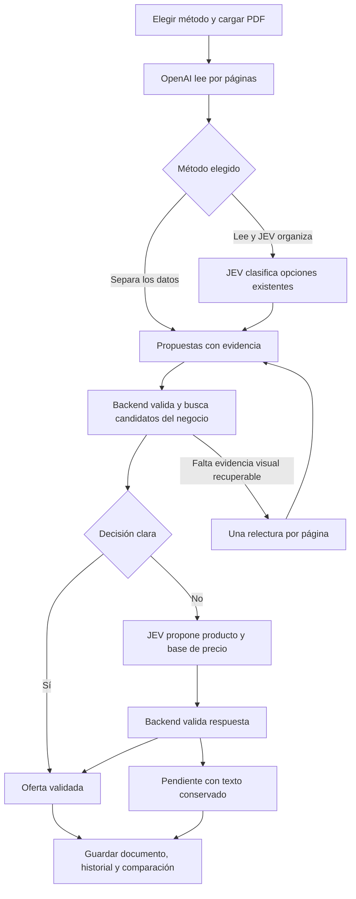

# Extracción con OpenAI y uso de JEV

Actualizado el 8 de octubre de 2026. Los dos métodos están implementados en el
backend y el frontend. El cierre y la verificación conjunta se registran en
[ORQUESTACION_DOS_METODOS.md](ORQUESTACION_DOS_METODOS.md).

**Revisión del 7 de octubre:** las corridas reales de Vital revelaron cortes de
lectura y fallas de candidatos/validación que las pruebas offline no cubrieron.
La [primera entrega de correcciones](CORRECCIONES_VITAL_2026_10_07.md) ya está
implementada y probada localmente; ese informe distingue lo terminado de lo pendiente.
La integración existe, pero esos folletos no quedaron correctamente resueltos.
El [plan de corrección](PLAN_CORRECCION_CORRIDAS_VITAL_2026_10_07.md) describe
los dos casos. El flujo siguiente es el comportamiento previsto y requiere esas
correcciones antes de considerarlo validado para este formato y volumen.

Gemini está suspendido para nuevas extracciones y para el piloto dual. Sus claves
no se eliminan; los documentos históricos mantienen su procedencia original.

## Elección al cargar el documento

- **OpenAI separa los datos** (`openai_structured`, predeterminado): OpenAI lee
  bloques y propone nombre, precio, presentación y otros campos, indicando el
  fragmento que respalda cada dato. El sistema valida esas propuestas y consulta
  JEV si quedan decisiones pendientes.
- **OpenAI lee y JEV organiza** (`openai_blocks_jev`): OpenAI transcribe bloques y
  fragmentos. El backend detecta valores posibles y JEV elige sus funciones entre
  opciones existentes. Luego se aplican las mismas validaciones y búsqueda del
  catálogo que en el primer método.

El selector consulta la disponibilidad al backend. B necesita configuración de
OpenAI y JEV. Una selección inválida o indisponible se rechaza antes de leer el
documento. No se ejecutan ambos métodos automáticamente. Si se cargan dos PDF,
se usa el mismo método en dos cargas consecutivas; un fallo de la segunda conserva
el enlace al primer documento guardado.

## Recorrido común

1. El backend guarda el archivo temporalmente y divide físicamente el PDF: una
   página por solicitud en A y dos en B. Agrupa las solicitudes en lotes que caben
   en sus lectores (hasta dos solicitudes en paralelo). Completa un lote antes de
   empezar el siguiente, renovando sus presupuestos. Intenta todas las páginas
   iniciales aunque un lote anterior sea lento o falle. Las sesiones de base de
   datos no se comparten entre esos lectores.
2. OpenAI devuelve fragmentos por página. El backend asigna identificadores y
   conserva texto, propuestas, referencias y versiones de lectura. Un dato ausente
   puede seguir ausente: no se inventa un precio para construir una oferta.
3. En B, JEV propone cómo clasificar los fragmentos y valores detectados: artículo,
   precio, contenido del envase, cantidad comercial, compra mínima, etc. Solo puede
   elegir opciones existentes; el backend construye los campos y verifica sus citas.
4. El backend recupera varios candidatos del catálogo del negocio, con presentación,
   marca y correcciones humanas. Recupera candidatos por lote y conserva el catálogo
   de la ejecución para evitar consultas repetidas por artículo.
5. Las reglas resuelven coincidencias y bases de precio claras. JEV recibe decisiones
   pendientes con una lista cerrada de candidatos; puede responder producto, ninguno
   o evidencia insuficiente. Para precio puede elegir unidad, pack o desconocido.
6. El backend valida cada respuesta. Producto y base de precio tienen estados
   separados. Dividir el precio por un pack requiere evidencia válida de su cantidad;
   una probabilidad alta por sí sola no lo autoriza.
7. Si falta evidencia visual recuperable, se permite una relectura adicional de esa
   página dentro del presupuesto común. Las dudas con texto disponible y las caídas
   de JEV quedan pendientes; no disparan otra lectura visual por sí solas. El flujo
   nuevo reemplaza la revisión visual separada de packs.
8. Se guarda el documento con ofertas utilizables y evidencia pendiente, incluso
   cuando no hay ninguna oferta con precio. La comparación y el historial muestran
   método, resultado parcial, ofertas sin vínculo y bloques pendientes.

## Qué decide JEV y qué se conserva

JEV trabaja sobre texto extraído y candidatos recuperados por el backend. No ve
datos que OpenAI omitió ni consulta o escribe directamente en la base. Su decisión
de pack se respalda con fragmentos del bloque o condiciones explícitamente asociadas
de la misma página. Contenido del envase, pack y compra mínima son conceptos distintos.

La aceptación de elecciones JEV está habilitada
(`DecisionThresholds.allow_jev_acceptance=True`). Identidad y base de precio exigen
probabilidad de la opción elegida de al menos 0,85, confianza de al menos 0,85 y
ventaja sobre la segunda opción de al menos 0,10. Siguen aplicándose las
validaciones de evidencia, presentación, candidato y cantidad comercial.
Los cuatro mínimos son configurables en el frontend para cada análisis. El backend
valida valores entre 0 y 1, los envía a JEV en `state.acceptance_thresholds` y guarda
los valores efectivos en la política del registro de auditoría. No cambia la
configuración de otros análisis ni reevalúa documentos históricos.
Las reglas pueden confirmar datos explícitos. Las propuestas ambiguas de JEV quedan
registradas para revisión; no se presentan como decisiones confirmadas.

Se conservan preguntas, opciones, respuestas, probabilidades, confianza y llamadas.
Cada relectura conserva la versión anterior. Una versión más débil no reemplaza
ofertas válidas ni elimina una variante que la nueva lectura omitió. Los pendientes
son visibles; su corrección humana detallada y un visor de toda la auditoría JEV
no forman parte de esta entrega.

La moneda ausente conserva la convención actual **ARS**. El ledger distingue el
campo extraído ausente del valor predeterminado de la ficha. Una moneda diferente
de ARS requiere revisión y no se compara directamente con costos del catálogo;
no se realiza conversión de monedas.

## Activación, límites y medición

La configuración local `.env.local` tiene `DOCUMENT_ANALYSIS_V2_ENABLED=true`:
ambos métodos se anuncian disponibles con los componentes y claves configurados.
Los procesos que ya estaban abiertos deben volver a cargar la configuración.
El valor
predeterminado del código y de `.env.example` sigue siendo false para permitir una
vuelta al recorrido anterior. Con false, A usa la lectura anterior de OpenAI y la
revisión visual de packs anterior; B se anuncia como no habilitado.

Cada lote tiene presupuestos de llamadas y tiempo con cuotas separadas para
lectura, clasificación y decisión. `DOCUMENT_ANALYSIS_MAX_CALLS` y
`DOCUMENT_ANALYSIS_TIMEOUT_SECONDS` ahora se aplican por lote, no al PDF completo.
Los lotes caben en los slots y en el cupo de lectura, por lo que sus solicitudes
iniciales se intentan aun si vence el plazo durante el lote. JEV y las relecturas
siguen sujetos al tiempo y los cupos. Los fallos de OpenAI conservan las páginas
como intentadas sin resultado; nunca se presentan como lectura completa.
La metadata conserva rangos, duración y reservas por lote, con versión
`bounded_batch_pipeline_v2`, y agrega llamadas/usage de todos los lotes.
Se conserva el modelo configurado; se desactivan los reintentos internos
de OpenAI. La importación sigue dentro de la petición HTTP, en un worker de FastAPI;
un PDF largo puede tardar más que el timeout configurado para un solo lote.
La metadata tiene un límite comprobado antes de persistir; no se trunca en silencio.

El resumen registra duración y usage cuando el proveedor los informa. Uso ausente
es desconocido, no cero. El costo permanece desconocido sin una tarifa identificada.
El benchmark permite comparar capturas A/B, pero sus fixtures son sintéticos.

Se verificaron componentes, API, persistencia aislada, tenant, recuperación y UI
sin llamadas pagas. **Falta evaluar documentos reales etiquetados para medir
omisiones, precisión, tiempo y costo.** No hay una cifra de ahorro demostrada.

Referencias de implementación:
[contratos](CONTRATOS_DOS_METODOS.md),
[plan](PLAN_DOS_METODOS_EXTRACCION.md),
[informe QA](agents/QA_IMPLEMENTACION_DOS_METODOS.md).

### Recuperación de citas del nombre

El lector estructurado usa `supplier_offer_structured_v3.md`: incluye ejemplos de
saltos de línea literales y separa las citas de precio de las de compra mínima.
El esquema de respuesta sigue siendo `supplier_offer_reader_v2`.
Si una cita de `raw_name` no existe literalmente, el backend permite sólo diferencias
de espacios entre los mismos términos, con una única coincidencia en el fragmento
legible declarado. Guarda el texto original y sus offsets como referencia;
la propuesta original permanece en la auditoría. No busca otros fragmentos,
no modifica palabras, cifras ni signos y no aplica esta recuperación a precios,
monedas, cantidades ni bases de precio. La recuperación del nombre no confirma
identidad de catálogo ni precio por unidad o pack.
